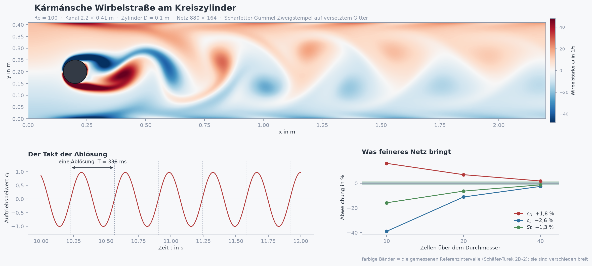

# Strömungsrechnung als Kirchhoffsches Netzwerk

Prof. Dr.-Ing. Ralph Wystup M.Sc. — erstellt mit KI und Agent (Claude Code, Anthropic)

**Seite öffnen:** https://ralphwystup.github.io/Stroemung-als-Kirchhoffsches-Netzwerk/ — das CFD-Labor 1.5.
Eine einzige Datei, die ohne Netz läuft: Sie rechnet die Kármánsche Wirbelstraße im Browser, und zwar auf
**zwei verschieden hergeleiteten Wegen gleichzeitig**. Neun Reiter, darunter alle Programme im Wortlaut.

Die Finite-Volumen-Methode **ist** ein Kirchhoffsches Netzwerk: Zelle = Knoten, Fläche = Zweig, und die
Kontinuitätsgleichung ist wörtlich die Knotenregel. Zähigkeit ist ein Widerstand, Trägheit ein Kondensator,
und die Konvektion — der Teil, den ein passives Netz nicht kann — ist eine **gesteuerte Quelle**. Sie steckt
in der Unsymmetrie des Zweigstempels nach Scharfetter-Gummel; lässt man die Geschwindigkeit gegen null
gehen, wird die Matrix symmetrisch und es bleibt das reine Widerstandsnetz übrig.

## Der Nachweis

Beweisstück ist die **Kármánsche Wirbelstraße am Kreiszylinder bei Re = 100**, der Benchmark 2D-2 von
Schäfer und Turek (DFG 1996). Bei dieser Reynoldszahl ist der Nachlauf echt zweidimensional — die Rechnung
ist also keine Vereinfachung, sondern vollständig. Die Referenzwerte sind eng eingegrenzt und von mehreren
Gruppen bestätigt; sie lassen sich nicht nachstellen.

Dazu steht ein **zweiter, unabhängig hergeleiteter Weg** daneben: Galerkin mit Taylor-Hood-Elementen (P2/P1)
auf einem körperangepassten Dreiecksnetz. Unabhängig heißt hier: andere Herleitung, nicht anderer Aufbau —
Flussbilanz am Kontrollvolumen gegen schwache Form, Zellmittel gegen Knotenwerte eines Polynomansatzes,
Treppenkontur gegen Rand auf Knoten.

| Größe | Netzwerk (144 320 Zellen) | Galerkin (18 503 Unbekannte) | Schäfer-Turek |
|:--|--:|--:|--:|
| c_D | +1,8 % | **3,2318** | 3,22 … 3,24 |
| c_L | −2,6 % | **1,0092** | 0,99 … 1,01 |
| Strouhal | im Intervall | **0,3002** | 0,295 … 0,305 |
| Δp | −1,0 % | — | 2,46 … 2,50 |

Ein ehrliches Ergebnis dazu: **Integralgrößen konvergieren erheblich schneller als die Felder.** Die
Beiwerte stimmen auf 1–2 %, die Wirbelstärkefelder punktweise nur auf 27 % (nahe am Körper 40 %). Ein
Benchmark bescheinigt die Beiwerte — nicht das Feld an jeder Stelle.

## Was in der Seite rechnet

Beide Rechenkerne laufen im Browser, nicht als Aufzeichnung:

* **Netzwerkweg** (`labor/kern_cfd.js`) — Zweigstempel, Drucknetz, Impulsoperator, vollständiger Löser
* **Galerkin-Weg** (`labor/kern_fem.js`) — P2/P1-Aufbau, Konvektion als Vektor, Sattelsystem mit MINRES
  und Cahouet-Chabard-Vorkonditionierer, konsistente Kraftermittlung
* **Vernetzer** (`labor/netz_browser.js`) — Randpunkte, Poisson-Streuung, Delaunay über Triangle

Beide sind **knotenweise** gegen die Python-Module geprüft: 45 und 47 Prüfposten, Hagen-Poiseuille auf
1·10⁻¹². Die Knopfprobe im echten Browser hat 68 Posten, das Prüfprotokoll 19 Stufen.

## Alle Programme liegen bei

Im Reiter **Programme** stehen alle 34 Dateien aus `stroemung/` und `labor/` im Wortlaut, jede mit
Zeilenzahl, Größe und sha256-Prüfsumme. Wer nachrechnen will, braucht die Quellen, nicht ihre Erwähnung.

## Was nicht bewiesen ist

Das Labor belegt **laminare zweidimensionale Strömung**. Für ein Lüfterrad — dreidimensional, turbulent,
drehend — rechnet es nichts nach und behauptet das nirgends. Der Weg dorthin führt über gemessene
Referenzdaten und eine 3D-Fassung. Auch die Fehlersuche steht offen: `BEFUNDE.md` führt 23 gefundene Fehler
mit der Antwort auf die Frage, warum die vorhandene Prüfung sie durchgelassen hat.

## Danksagung

Die körperangepassten Dreiecksnetze wurden mit **Triangle** erzeugt, dem Netzgenerator und
Delaunay-Triangulierer von **Jonathan Richard Shewchuk** (Carnegie Mellon University) — demselben, den auch
FEMM benutzt. **Mit Dank an den Autor.**

- J. R. Shewchuk: *Triangle: Engineering a 2D Quality Mesh Generator and Delaunay Triangulator.*
  Lecture Notes in Computer Science 1148, S. 203–222, Springer-Verlag 1996.
- J. R. Shewchuk: *Delaunay Refinement Algorithms for Triangular Mesh Generation.*
  Computational Geometry: Theory and Applications 22(1–3):21–74, 2002.

## Lizenz

**MIT** für den eigenen Teil, siehe [LICENSE](LICENSE).

**Ausgenommen ist Triangle** (`labor/triangle/`, in `CFD_Labor_1.5.html` eingebettet): urheberrechtlich
geschützt, für Forschung und Lehre frei, aber ohne Lizenz des Autors weder verkäuflich noch in ein
kommerzielles Erzeugnis aufzunehmen. Die MIT-Lizenz gilt dafür nicht und kann dafür keine Rechte einräumen.

Dabei ist die Abhängigkeit **eng**: `labor/kern_fem.js` — der ganze Galerkin-Löser — enthält die
Zeichenfolge „Triangle" kein einziges Mal; der Vernetzer ruft ihn in fünf Zeilen auf, über eine Punktliste
hinein und eine Dreiecksliste heraus. Wer den Weg kommerziell nutzen will, tauscht diese fünf Zeilen gegen
gmsh, Netgen oder CGAL und hat den vollständigen, MIT-lizenzierten Löser ohne Triangle-Bindung.

Einzelheiten in [LIZENZ.md](LIZENZ.md) und `labor/triangle/HERKUNFT.md`.
